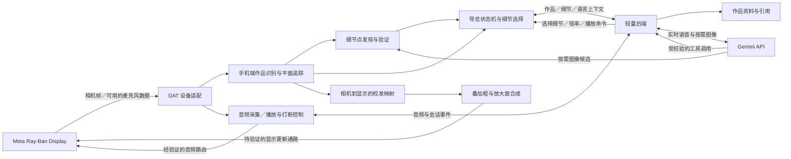

# 技术文档

> 当前实现基线（2026-11-15）：iOS 0.2.4 / build 8（`c87da7e`）已在指定 iPhone 完成安装，启动与框可见性仍待用户确认。发布记录及模拟器证据显示：手机预览已放大，细节框加粗并编号，概览期间增加作品虚线框；列表加载即显示、标题三词限制已有实现。眼镜 Display 跟随框及现实对齐仍未实现，环形倒计时尚未交付。下文 0.2.3 的现象与核查是历史依据，不覆盖这些更新；P02／BUG-02 继续按 **No.1／P0** 推进，不能从模拟器结果推断手机／镜片验收通过。详见[测试进度](10-ios-simulator-test-progress.md)和[0.2.4 Release](https://github.com/Teeeeeemo/Junction_Hannah_family_Meta_AI/releases/tag/v0.2.4-ios-preview.1)。

版本：v0.4 · 2026-11-15（Europe/Helsinki）
对应需求：[PRD v0.4](01-product-requirements.md)
状态：设计包含尚未完成的目标能力；最新实现与实测以 docs/10 为准。手机二维追踪框实测未实现可用效果，不能由已有追踪代码认定完成。

实现更新（2026-11-14）：本地 Simulator MVP 已构建，用户选择 Gemini，真实视觉、问答、Live 音频与中英翻译已完成最小联调。以下仍包含最终设备阶段设计；实际接口、验证范围和未完成项以 [MVP 运行记录](05-mvp-runbook.md) 为准。

## 当前 No.1：跟随检测框修复（待实现／待验证）

执行优先级以 [PRD 的 No.1 要求](01-product-requirements.md)为准，先修复 P02／BUG-02，再进行非依赖的提速及新增 UI 工作。0.2.3 源码核查发现：

- `MuseumPhoneView` 仅在 `trackedDetailBox` 有效时在顶部视频预览绘框；概览未选中细节时不会产生细节框。须验证实际图像显示区域与坐标映射，不能用整个容器尺寸代替等比显示后的图像区域。
- `ArtworkTracker` 使用作品级 `VNTrackObjectRequest`，以轴对齐缩放／平移映射细节。追踪低置信、结果超过 300 ms 或细节超出参考区域等条件会导致无框；Vision 异常目前统一返回 `lost`。这些是排查入口，并非已证实的现场根因。应保留可区分的失败原因、帧时间戳、坐标空间、置信度及 UI 是否实际绘制的诊断信息。
- `TourSnapshot` 没有追踪几何；`GlassesDisplay` 只消费文字、按钮和裁剪图，没有跟随框渲染通路。须设计携带会话／作品／点位版本、帧时间戳、坐标空间和有效状态的几何数据，拒绝迟到结果；再使用经验证的公开 Display API 绘制。
- 手机图像坐标、模拟 Display 坐标和真实镜片投影分别处理；二维透视变化需要合适的平面几何方法和回归素材，3D 不纳入本轮修复。真实眼镜投影能力先按 Gate 0 验证，未测不得宣称可用。

先交付可重放视频及手机相机的框与日志证据，再交付模拟显示证据，最后进行镜片对齐／延迟验收。失跟继续讲解、清无效框及新点约 2.5 秒等待上限保持一致，详见[专项验收](04-validation-and-delivery.md)。

## 1. 总体方案与关键结论

建议采用 **一个原生手机 App + Meta DAT + 本地二维追踪 + 单一实时语音服务 + 小型内容后端**。主平台尚待用户在文档完成后选择，Android 是当前环境下的建议优先项。

当前用户没有实体眼镜，官方 Chrome 显示模拟器已启动。因此先以电脑相机／视频、电脑音频与模拟显示适配层开发原型；最终 DAT 架构和真机验收保留。原型可验证业务流程，不以浏览器画框代替 A 版现实对齐。

**当前产品规则（2026-11-15 最新确认，PRD v0.4）：** 细节列表加载并校验完成即在眼镜 Display 右侧显示，概览朗读期间也可展示和选点，不再等待概览结束。没有用户改选时，仍在概览结束／跳过且列表就绪后自动讲 1 号。概览及每个细节分别使用独立的环形朗读倒计时，切段重置；细节列表标题最多三个单词。失跟只隐藏无效框和局部窗，正在进行的讲解继续；新点最多等待约 2.5 秒定位，超时仍讲解，可靠定位恢复后再显示框和局部窗。用户暂停、打断、结束仍须生效；无可靠作品／细节点时不得凭空讲解。列表时序、倒计时和标题限制是待实现的新要求，不代表已安装的 0.2.3 已支持。

必须分开验证三件事：

1. 在相机画面中找到作品与细节。
2. 将框送到眼镜显示区域，并足够频繁地更新。
3. 让佩戴者看到的框与真实细节对齐，包括头部移动和观看距离变化。

第 1 项包括语义上的“发现可讲细节”和几何上的“定位／追踪”。平面图像匹配只解决后者，不能单独发现语义细节点。第 2、3 项尚未证实。SDK 支持显示图文不等于支持世界坐标锚定、相机到人眼投影或低延迟自定义叠加。

**Gate 0 通过前，不应把 A 版写成已可交付的事实。** 此门槛是产品核心的验证任务，不是自动缩减需求的授权。

## 2. 架构



手机负责连续视觉处理与状态；云端负责自然语言与讲解。连续追踪不经过云端往返。所有设备 API 包在适配层，iOS／Android 的业务状态与数据约定保持一致，但第一版只实现一端。

### 2.1 模块职责

| 模块 | 输入 | 输出与责任 |
|---|---|---|
| DeviceAdapter | DAT 事件 | 注册、设备状态、相机帧、时间戳、权限和显示发送结果 |
| ArtworkTracker | 当前帧、已登记参考图 | 作品 ID、单应矩阵、角点、质量、追踪状态 |
| DetailDiscovery | 当前作品帧、参考图、语义候选和资料 | 经位置校验的细节点候选；不能从固定清单伪造自动发现 |
| DetailList | 已验证候选、list_version | 右侧列表、稳定编号、可见状态与当前项高亮 |
| DetailSelector | 编号／名称／列表确认／辅助对准指令 | 编号到稳定 detail_id 的映射、选点版本和锁定状态 |
| DisplayCalibration | 相机点、校准参数、适用范围 | 可显示的投影位置或无效状态 |
| OverlayRenderer | 投影轮廓、裁剪图、倍率 | 不显示全屏相机底图的叠加画布；实际传输方式待验证 |
| TourController | 设备、追踪、用户、云事件 | 唯一权威会话状态和命令序列 |
| AudioController | 输入音频、返回音频、VAD、用户停止 | 播放队列、回声处理、打断、实际已播时长 |
| ContentService | 作品／细节 ID、问题 | 经引用支持的内容片段 |
| RealtimeBridge | 音频、资料、有效上下文 | 语音回答、转写、受校验工具调用 |

## 3. Gate 0：A 版的可行性验证

### 3.1 显示通路

官方 Android 示例提供内容发送、图片和视频等显示路径；每次内容发送替换上次内容，视频示例采用独立根视图。这些材料没有证明任意像素位置的持续绘制、相机投影或图片连续刷新的性能。[官方 Display 指南](https://github.com/meta/meta-wearables-dat-android/blob/main/plugins/mwdat-android/skills/display-access/SKILL.md)

验证顺序：

1. 运行官方 DisplayAccess，确认真机能显示且有交互。
2. 查看实际 SDK 的公开类型，确认能否按预定显示范围呈现合成画布：黑色底、细框、右侧编号列表，以及放大时的右上角裁剪图和右下列表。
3. 尝试公开 API 支持的图片／帧更新，测量实际刷新、队列、吞吐和显示延迟；不要假设每次 sendContent 都会及时显示。
4. 若 SDK 提供低延迟帧流路径，再以官方 API 验证；已找到的 URL 视频示例不能当作原始帧流 API。
5. 确认相机采集、显示、麦克风和音频播放在同一会话下可并行工作。

尚未确认存在 Canvas、世界锚点、原始显示视频帧上传或相机→显示校准 API；实现时不得虚构这些方法。若图片／视图路径不能达到跟随要求，应明确停止扩大开发范围，向用户提交证据与选择。

### 3.2 真实对齐

对二维画作，可通过每帧匹配得到画面内的位置；但人眼与相机有位置差，镜片显示也有自己的投影。将相机坐标直接按分辨率缩放到显示坐标会产生视差与位置误差。

可尝试的受限演示方案：固定平面作品和观看距离，在已知佩戴条件下由佩戴者完成多点对齐校准；用未参与拟合的验证点检查误差。该方案是否足够稳定，取决于实际显示接口、可用视野、观看位置和佩戴变化。它是待验证方案，不能宣传成任意距离的通用 AR 锚定。

同一作品内的平面关系不等于相机到眼睛的映射。跨观看距离时需要深度／相对位姿和相应标定；一个固定二维映射不能自动解决。换人、重新佩戴、明显滑动或超出校准范围后，应要求重新校准或隐藏框。

### 3.3 通过条件

静止与规定移动范围内，满足 PRD 的实际视野对齐和跟随目标；支持框、右侧列表与局部窗同时显示；音频并行可用。记录具体设备、固件、软件版本、观看距离、显示更新率、延迟分布与校准误差。

没有真机数据时，状态只能是“待验证”。浏览器模拟、屏幕录制或平面算法测试均不能单独使本门槛通过。

## 4. 二维作品识别与持续追踪

### 4.1 内容准备

对每幅画准备一张参考图、唯一 artwork_id 和可靠资料。可准备人工标注作为验证集，但运行时必须根据实际输入画面发现或确认点位，再形成右侧列表；不得直接把人工清单显示出来并称作自动发现。

本次会话中的细节点使用稳定 detail_id、显示编号、名称、参考平面多边形、发现帧、可见状态和资料关联。几何坐标归一化为 [0,1]，保存图像宽高、方向和版本。第一版建议每幅画目标发现约 3 个可靠点，找不到时不凑数。

### 4.1.1 自动发现与几何定位分开实现

1. 从当前作品的清晰、稳定帧创建发现任务；允许一次分析生成概览和细节点，或在概览生成／朗读期间并行发现。列表校验就绪即呈现；自动细节讲解仍在概览完成／跳过后启用，用户主动改选优先。
2. 通过现有多模态服务的按需图像输入提出候选名称、区域与视觉依据，或在已知作品库中自动检测已登记细节。实现和测试必须注明采用“开放候选发现”还是“库内细节检测”，不能混淆两者。
3. 检查候选属于当前作品、区域有效、没有重复；与当前帧及参考图进行定位校验。模型粗框不直接作为可靠跟随框，语义确认与定位质量分别记录。
4. 将区域转换到参考平面，分配稳定 detail_id；对第一批可靠候选按可讲顺序建立编号 1…N。编号由应用分配，模型不能直接改写用户正在使用的编号。
5. 发现结果校验完成即发布 list_version 并显示右侧列表，不以概览结束为显示条件。概览结束／跳过且列表就绪、用户未改选时才默认请求锁定 1 号，定位成功即开讲，否则最多等待约 2.5 秒仍开讲。框和局部窗严格依赖可靠定位；没有可靠细节点时显示空／重新对准状态。
6. 连续追踪走本地几何路径，不逐帧调用语义模型。必要重识别只更新位置与可见性；后续新增点追加到列表，不重排原编号。

运行时识别出的新细节如缺乏历史资料，仅提供可靠的视觉观察或说明资料不足。自动发现不能成为生成无依据背景故事的通路。这部分是 v0.2 的新增开发任务，尚未验证识别质量与耗时。

### 4.2 算法建议

参考图特征预计算 → 当前帧特征提取与匹配 → RANSAC 估计单应矩阵 → 投影作品角点和细节轮廓 → 高质量帧之间使用光流跟随 → 周期性重新匹配。

OpenCV 的特征匹配与单应性方法可用于把已知平面图像定位到另一幅图像中；RANSAC 可以剔除错误匹配。[OpenCV 官方教程](https://docs.opencv.org/4.x/d1/de0/tutorial_py_feature_homography.html)

实现初选 ORB + Hamming 匹配；若参考图特征不足或稳定性不好，再比较 SIFT。使用光流时要做前后向误差与重投影检查。不要仅凭“检测到几个点”便显示框。

```text
reference detail polygon
    -- H(reference→camera, timestamp) --> camera polygon
    -- calibrated projection --> display polygon
    -- clipping to visible display --> overlay or out-of-view state
```

若采用归一化参考坐标 p_r，先转换为参考图像像素，再应用：

\[
\lambda [u_c,v_c,1]^T = H_{r\rightarrow c}[u_r,v_r,1]^T
\]

此 H 只把参考作品映射到相机图像，**不直接映射到佩戴者视野**。

### 4.3 初始参数（待调试）

| 参数 | 初始建议 | 调整依据 |
|---|---|---|
| 相机采集 | 从 15 或 24 FPS、中档质量开始 | 真机带宽与纹理清晰度 |
| 本地追踪 | 消费最新可用帧，不积压历史帧 | 时间戳与端到端延迟 |
| 重识别 | 每秒 1–2 次或质量下降时触发 | CPU、遮挡和漂移 |
| 匹配门槛 | 至少 20 个有效内点、内点比率初值 0.5 | 实际作品数据分布 |
| 质量控制 | 重投影误差、面积、凸性、连续性联合判断 | 降低误框 |
| 候选停留 | 初值 600 ms，再明确确认 | 误触与响应速度 |
| 失效上限 | 最近可靠观测超过 300 ms 则隐藏框 | PRD A04 |

这些不是 SDK 限制，也不是实测最优值。采用丢弃旧帧、单个在途任务的背压方式；不可用长队列换取表面的高帧率。

### 4.4 右侧编号列表、自动 1 号与用户改选

- 列表项由 display_number 映射到稳定 detail_id，带名称、is_visible、is_current 和讲解状态。列表焦点与当前讲解项分开，方向键浏览不会直接切换讲解，确认才提交。
- 通识介绍完成且列表就绪后，仅触发一次默认选 1 号；延迟到达的自动选点任务不得覆盖用户已提交的选择。1 号失跟时标记暂不可见并重新定位，当前讲解继续，不把其他点改名为 1 号。
- 默认按原编号顺序讲解；用户起声时停止音频并暂停自动推进。选点指令优先于自动队列、语音补全和旧的发现任务。
- 用户可通过右侧列表、编号或名称改选；提交后增加 selection_version，取消旧音频／旧定位请求，立即更新当前选择及高亮，清除旧框／局部窗；可靠定位后显示新几何。新点语音定位等待最多约 2.5 秒，不可见时也继续讲解并提示，手动暂停和打断优先。
- 同一点普通追问只保留当前选择；选点指令则切换。“继续”恢复当前点，“下一个”选择下一个未讲完点，不默认回到 1 号。
- 按名称和别名消歧，例如“那条链子”；无效编号、跨旧列表编号或多目标歧义先澄清。
- 头部对准可以保留为辅助选择方式；不宣称读取眼球注视。自动与手动选择共用追踪和失跟处理。

## 5. 校准与延迟

校准数据至少绑定：眼镜标识、显示尺寸／内容变换、相机裁剪和旋转、佩戴者会话、距离范围、拟合参数、独立验证误差和校准时间。

校准程序建议采集 9 个分布在有效区域的对齐点，另留独立验证点；以真实佩戴者对齐为准，不以屏幕上的相机预览代替。仅在验证过的观看条件中使用映射。

端到端时间组成：采集 → 手机收到帧 → 解码／追踪 → 投影／合成 → 发送 → 实际呈现。使用单调时钟记录本地时间；设备时间与手机时间需要估计偏移，不能直接相减。记录 frame_id 和发送序号，区分处理耗时与实际显示延迟。

IMU 可用于尝试短时方向预测，但不能解决视差、平移深度或错误校准；加入预测前先比较其是否真的降低佩戴者看到的误差。显示更新频率上限也必须实测。

若没有公开的实际呈现时间戳，可使用高速外部相机／人工标记和佩戴者对齐记录估计；报告测量误差，不把 sendContent 返回时间当成呈现时间。

## 6. 2×／4×局部放大窗

### 6.1 布局

将实际可用显示区域记为 W×H，内容坐标不含系统保留区域：

```text
window left = W / 2
window top = 0
window width = W / 2
window height = H / 2
```

可加入安全边距，保持“约半宽、半高”的产品约定。若 SDK 不能让框与局部窗按此布局同时呈现，记为未通过，而非默认改布局。

v0.2 增加右侧编号列表：未放大时右侧使用简短可滚动列表；放大时建议把列表放在右下区域，即 left=W/2、top=H/2、width=W/2、height=H/2，右上保留原放大窗。需验证文字、焦点和选中态可读，不能以局部窗遮住列表的选点入口。

### 6.2 倍率定义

锁定细节时确定基础取景框 B0，包含细节及适当边缘。B0 是该次锁定的 1×基准，在作品参考平面上固定：

\[
w_z=w_0/z,\quad h_z=h_0/z,\quad z\in\{1,2,4\}.
\]

围绕同一中心截取 Bz，并缩放到固定窗口。基准 B0 应足以使 2×仍有可辨认上下文；4×允许聚焦细节中的更小区域。切换倍率不会重新定义 B0，因此可测试真实线性倍率。

建议将当前相机画面按作品平面矫正，再从对应区域裁剪，以降低斜视时窗口抖动。取样越界用可用区域和边界提示处理，不拉伸变形。如果使用馆方高清参考图增强可读性，界面必须标明“参考图”，不能冒充实时相机画面；实时裁剪仍是用户当前要求的默认来源。

数字放大不会创造传感器没有捕获到的内容。不在讲解中据低清插值图确认细小笔触或修复痕迹。

## 7. 实时语音与问答

### 7.1 最快接入建议

用户已有 Gemini Key，本次已采用 **Gemini 图像／文本 API + Gemini Live API**。图像识别、问答和翻译通过本地后端 REST 请求，语音通过后端 Live 代理；单一提供商完成云端功能，本地追踪无需另购模型。[Gemini Live 概览](https://aistudio.google.com/docs/live-api)

本机已验证的模型配置为 `GEMINI_MODEL=gemini-3.8-flash` 与 `GEMINI_LIVE_MODEL=gemini-2.5-flash-native-audio-preview-12-2025`。视觉模型选择经过真实账户错误信息与成功请求确认；Live 模型也返回了实际音频。后续以账户可用性为准，不自动使用未经测试的替代模型。

仅在发现细节、必要重识别、切点和提问时发送必要图像；连续追踪不逐帧调用云端。模型区域、工具参数与来源都由应用校验。原 OpenAI 方案保留为日后备选，本轮不同时接入两家。

### 7.2 音频通路与权限

建议通路：眼镜麦克风 → DAT 已授权音频数据 → 手机音频控制 → 后端实时服务 → 手机播放器 → 经验证的眼镜输出路由。

Android 官方音频流能力当前属于实验能力，需要相应开发者配置和权限；模拟器不能证明真实麦克风 PCM 一定可用。[官方音频流指南](https://github.com/meta/meta-wearables-dat-android/blob/main/plugins/mwdat-android/skills/audio-streaming/SKILL.md)

API 选型不会自动解决设备权限。Gate 0 必须验证实际麦克风、输入采样率、播放路由、并发以及回声。如果只能用手机麦克风进行开发，应明确标注测试来源，不能宣称眼镜语音已通过。

内部音频约定先设为 mono PCM16 little-endian，采样率由供应商实际会话配置决定。DAT 若输出 16 kHz 而下游要求 24 kHz，要真实重采样；不得只改格式标签。输出也要匹配播放器格式。输入和输出全双工需测试回声造成的误打断。

### 7.3 打断实现

1. 检测到本地可靠起声或服务端 speech-start 事件时，优先清空本地播放队列；不用等新回答到达。
2. 取消旧回答；给音频块与工具请求绑定 turn_id／response_id。旧轮次迟到的数据一律丢弃。
3. 告诉服务端用户实际听到了多少音频，使对话上下文不包含未播放部分；具体使用所选 API 的取消／截断事件。
4. 新提问绑定起声时的 artwork_id、detail_id 和 context_version，避免用户转头后代词指向新作品。
5. 区分普通追问与改选点位：普通问答后等待继续指令；选点时解析编号／名称并提交 selection_version，直接讲解新点，旧自动队列不能再恢复旧点。恢复时不重放未清除的音频缓冲。

服务商文档说明了 WebSocket 客户端需要处理播放中断及已听音频截断，单开 VAD 不足以实现端侧完整体验。[Realtime 对话与中断](https://developers.openai.com/api/docs/guides/realtime-conversations)

按钮可作为中断辅助，但不能替代自然语音验收。语音输入权限缺失时，P06 仍视为未通过。

## 8. 内容与来源

第一版使用随 App／后端发布的小型 JSON 内容包，无需先搭建向量数据库。按作品 ID 和细节 ID 精确获取相关资料，减少错误召回。

每个可讲解事实使用 claim_id，绑定 source_ids 与定位信息。来源内容先人工核对并整理，模型只在这些材料支持的范围内解释；无依据时返回资料不足。馆藏网页是来源，模型生成的网页标题不是来源。

云端工具建议：

| 工具 | 参数 | 作用 |
|---|---|---|
| get_artwork_context | artwork_id, language | 返回作品概览、可讲内容、来源 ID |
| get_detail_context | artwork_id, detail_id, language | 返回当前细节、观察与历史解释 |
| propose_detail_candidates | artwork_id, frame_id, context_version, candidates | 提交按需图像候选；应用做几何、归属与重复校验后才发布列表 |
| get_detail_list | artwork_id, list_version | 返回本次会话的编号、稳定 ID、名称、可见状态和当前点 |
| select_detail | detail_id 或 display_number, list_version, context_version | 校验编号映射；选择时暂停旧任务，新点定位成功或约 2.5 秒等待到期后开始讲解，视觉显示仍要求可靠定位 |
| set_zoom | factor, context_version | 只接受 1、2、4 |
| set_language | language | 切换当前语言，保留视觉上下文 |
| control_tour | action | 只接受 pause、resume、next、stop |
| get_sources | claim_ids | 返回已有资料，拒绝不存在的 ID |

工具调用是请求，状态机仍拥有最终决定权。放大、切换和暂停等本地操作无需等长段模型解释完成。

## 9. 数据与接口约定

以下为拟定的应用协议，不是 Meta SDK 已提供的 API。

### 9.1 作品数据

```json
{
  "schema_version": "1.1",
  "artwork_id": "museum-object-id",
  "reference_image": {"path": "artwork.jpg", "width": 2000, "height": 1600, "sha256": "..."},
  "title": {"zh": "中文名", "en": "English title"},
  "list_version": 1,
  "details": [{
    "detail_id": "detail-01",
    "display_number": 1,
    "name": {"zh": "目标名称", "en": "Detail name"},
    "discovery": {"method": "runtime_detection", "frame_id": "frame-001"},
    "visibility": "visible",
    "polygon_normalized": [[0.2, 0.2], [0.4, 0.2], [0.4, 0.5], [0.2, 0.5]],
    "aliases": {"zh": ["目标名称"], "en": ["detail name"]},
    "claim_ids": ["claim-01"]
  }],
  "claims": [{"claim_id": "claim-01", "kind": "fact", "text": {"zh": "...", "en": "..."}, "source_ids": ["source-01"]}],
  "sources": [{"source_id": "source-01", "title": "Museum collection record", "url": "https://museum.example/object", "locator": "section", "accessed_at": "2026-11-14"}]
}
```

数据校验：ID 和编号各自唯一；编号从 1 开始，本次作品会话中不因移动、失跟或语言变化重排；多边形有效且在作品范围内；发现帧属于当前 context_version；引用指向存在的 claim/source；中英字段齐全；图像版本改变后旧标注失效。静态内容包与运行时发现结果分开保存，示例占位文本不进入演示内容。

### 9.2 本地 TrackingResult

```text
frame_id, monotonic_received_at, artwork_id,
reference_to_camera_homography, detail_polygons_camera,
inlier_count, inlier_ratio, reprojection_error,
tracking_status, calibration_id, context_version, list_version, selection_version
```

相机旋转、镜像、裁剪和分辨率变换必须显式记录。任何 overlay 都能追溯到对应帧和校准，不共享无版本的全局框坐标。

### 9.3 后端接口草案

| 接口 | 功能 |
|---|---|
| GET /health | 服务存活和配置是否完整，不返回密钥 |
| GET /artworks | 返回内容包版本、作品与细节清单 |
| POST /sessions | 建立本应用会话，返回 session_id 和短期连接凭据 |
| WS /sessions/{id}/voice | 经认证的语音、会话事件和来源事件 |
| POST /sessions/{id}/context | 更新作品／细节／列表版本／选点版本／语言 |
| DELETE /sessions/{id} | 停止模型会话并清理资源 |

应用事件包含 event_id、session_id、context_version、list_version、selection_version、turn_id 和类型。控制命令带 command_id，重复命令幂等处理；旧上下文／旧列表／旧选点命令被拒绝。音频帧和 JSON 控制消息使用明确、不同的消息类型。

### 9.4 新 UI 状态与数据约定（PRD v0.4，待实现）

- 列表呈现依赖有效 `points/list_version`，移除 `GlassesDisplay.pointsRevealed` 以首次选点为门槛的旧行为；不得通过提前选中 1 号来强行显示列表，避免中断概览。
- 每段播放引入 `section_id`（overview 或 detail_id）、`playback_id`、实际已播音频时长、可用总时长、估计标记及暂停／缓冲状态。环和剩余时间使用同一快照分发到手机与 DAT，旧版本事件丢弃。
- 时长已知时：剩余现实时间 = max(0, 段音频总时长 − 已播放的原始音频时长) / 当前倍速。避免对已经按墙钟计时的时长重复除以倍速。以播放器消费进度计时，不用“收到 PCM 字节数”代替已播放量。
- Gemini Live 完整段长度未确定前仅显示明确标注的估计；无法估计时显示生成／待估算状态。暂停、缓冲、用户打断不能继续消耗原段时间；切段重置，完成依赖实际播放结束回调。
- 数据新增独立短标题字段（建议 `display_title`）；保留原名称／别名与 detail_id。后端生成／翻译校验英文最多三词，中文使用明确分词规则；前端再次校验并做宽度保护。不要更改编号／身份以适配短标题。
- 定时 UI 更新须限频且与取帧、追踪、麦克风处理解耦；验证 DAT 环形绘制能力与更新成本。如公开组件不支持圆环，应报告具体限制，不把静态圆形或任意旋转动画当作朗读倒计时。

## 10. 状态与故障恢复

视觉状态与语音状态分开建模，允许用户提问时继续追踪。

```text
视觉：DISCONNECTED → READY → RECOGNIZING → TRACKING ↔ LOST
发现／列表：DISCOVERING → DETAIL_LIST_READY（就绪即显示，与 OVERVIEW 并行）
导览：IDLE → OVERVIEW → [概览结束或跳过 + 列表就绪 + 用户未改选] DETAIL_AUTO(1) → DETAIL_AUTO(next) / DETAIL_SELECTED(n) → PAUSED / ENDED
用户改选：OVERVIEW / DETAIL_AUTO → DETAIL_SELECTED(n)（优先于自动首点）
语音：SILENT ↔ PLAYING → INTERRUPTED → LISTENING → ANSWERING → SILENT
```

新作品确认时递增 context_version，取消旧讲解和旧工具请求。失跟时清除失效框；来源与语音上下文可保留，但不得继续用“框中的这里”指示一个已不可见的位置。

列表由结果就绪事件立即显示，与概览完成事件解耦；概览完成事件仅在列表就绪且无用户改选时幂等触发自动 1 号。用户选择、语音停止和界面更新经同一状态机提交。每次切点增加 selection_version，渲染与音频只消费当前版本，防止新点高亮后旧音频／旧框又出现。

断网后停止创建新云请求，保留已缓存的固定内容；重新连接时创建新的语音轮次并同步上下文，不重放旧音频。停止会话时释放相机、输入、麦克风、显示观察者、模型连接与播放队列。

## 11. 资源与安全边界

主 API Key 只在后端环境变量／密钥配置中保存，不打包进手机或 Web。手机连接后端使用短期凭据；限制单会话时长、并发、上传图片大小和可调用工具。

默认不持久保存原始相机流和麦克风音频；调试日志记录时间、状态、帧 ID 和错误码。演示录制另行明确范围。首次进入语音体验时以简短提示说明声音由 AI 生成，不在每次播放时重复打扰。

仅在作品上下文变化、细节点发现／必要重识别和提问时上传选定图像，连续跟随保留在本地。成本按实际返回 usage 统计，达到应用级时长／预算上限时结束云会话，避免依赖账单提醒实现硬限额。

## 12. 3D 高级功能

单应性只适用于平面或受限近似，不应用于环绕 3D 物体的细节框选。可先做一个固定对象、受限视角的识别与讲解示例；若要求任意视角细节跟随，需要另做 3D 关键点／模型／位姿和遮挡处理。

3D 内容应有独立验收，不得以二维画中出现一尊雕像，或播放一张物体照片，宣称真实 3D 功能已经完成。

## 13. 开发进入条件

当前无实体眼镜：先完成模拟器适配与一幅作品的“通识介绍 → 自动发现 → 右侧列表 → 1 号讲解 → 打断改选与持续追踪”，再扩作品。确定手机主平台并取得眼镜后，运行对应官方示例和 Gate 0，单独验证现实对齐。完整测试、交付与限制披露见[后续计划](04-validation-and-delivery.md)。
