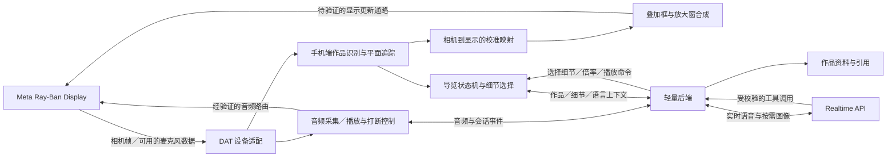

# 技术文档

版本：v0.1 · 2026-11-14（Europe/Helsinki）  
对应需求：[PRD v0.1](01-product-requirements.md)  
状态：技术设计与可行性验证方案；没有已构建的 App、API 联调或真机测试结果。

## 1. 总体方案与关键结论

建议采用 **一个原生手机 App + Meta DAT + 本地二维追踪 + 单一实时语音服务 + 小型内容后端**。主平台尚待用户在文档完成后选择，Android 是当前环境下的建议优先项。

必须分开验证三件事：

1. 在相机画面中找到作品与细节。
2. 将框送到眼镜显示区域，并足够频繁地更新。
3. 让佩戴者看到的框与真实细节对齐，包括头部移动和观看距离变化。

第 1 项可以设计为标准的平面图像匹配问题；第 2、3 项尚未证实。SDK 支持显示图文不等于支持世界坐标锚定、相机到人眼投影或低延迟自定义叠加。

**Gate 0 通过前，不应把 A 版写成已可交付的事实。** 此门槛是产品核心的验证任务，不是自动缩减需求的授权。

## 2. 架构



手机负责连续视觉处理与状态；云端负责自然语言与讲解。连续追踪不经过云端往返。所有设备 API 包在适配层，iOS／Android 的业务状态与数据约定保持一致，但第一版只实现一端。

### 2.1 模块职责

| 模块 | 输入 | 输出与责任 |
|---|---|---|
| DeviceAdapter | DAT 事件 | 注册、设备状态、相机帧、时间戳、权限和显示发送结果 |
| ArtworkTracker | 当前帧、已登记参考图 | 作品 ID、单应矩阵、角点、质量、追踪状态 |
| DetailSelector | 候选细节、选择区域、确认／语音指令 | 稳定的 detail_id 与锁定状态 |
| DisplayCalibration | 相机点、校准参数、适用范围 | 可显示的投影位置或无效状态 |
| OverlayRenderer | 投影轮廓、裁剪图、倍率 | 不显示全屏相机底图的叠加画布；实际传输方式待验证 |
| TourController | 设备、追踪、用户、云事件 | 唯一权威会话状态和命令序列 |
| AudioController | 输入音频、返回音频、VAD、用户停止 | 播放队列、回声处理、打断、实际已播时长 |
| ContentService | 作品／细节 ID、问题 | 经引用支持的内容片段 |
| RealtimeBridge | 音频、资料、有效上下文 | 语音回答、转写、受校验工具调用 |

## 3. Gate 0：A 版的可行性验证

### 3.1 显示通路

官方 Android 示例提供内容发送、图片和视频等显示路径；每次内容发送替换上次内容，视频示例采用独立根视图。这些材料没有证明任意像素位置的持续绘制、相机投影或图片连续刷新的性能。[官方 Display 指南](https://github.com/meta/meta-wearables-dat-android/blob/main/plugins/mwdat-android/skills/display-access/SKILL.md)

验证顺序：

1. 运行官方 DisplayAccess，确认真机能显示且有交互。
2. 查看实际 SDK 的公开类型，确认能否按预定显示范围呈现合成画布：黑色底、细框、右上角裁剪图。
3. 尝试公开 API 支持的图片／帧更新，测量实际刷新、队列、吞吐和显示延迟；不要假设每次 sendContent 都会及时显示。
4. 若 SDK 提供低延迟帧流路径，再以官方 API 验证；已找到的 URL 视频示例不能当作原始帧流 API。
5. 确认相机采集、显示、麦克风和音频播放在同一会话下可并行工作。

尚未确认存在 Canvas、世界锚点、原始显示视频帧上传或相机→显示校准 API；实现时不得虚构这些方法。若图片／视图路径不能达到跟随要求，应明确停止扩大开发范围，向用户提交证据与选择。

### 3.2 真实对齐

对二维画作，可通过每帧匹配得到画面内的位置；但人眼与相机有位置差，镜片显示也有自己的投影。将相机坐标直接按分辨率缩放到显示坐标会产生视差与位置误差。

可尝试的受限演示方案：固定平面作品和观看距离，在已知佩戴条件下由佩戴者完成多点对齐校准；用未参与拟合的验证点检查误差。该方案是否足够稳定，取决于实际显示接口、可用视野、观看位置和佩戴变化。它是待验证方案，不能宣传成任意距离的通用 AR 锚定。

同一作品内的平面关系不等于相机到眼睛的映射。跨观看距离时需要深度／相对位姿和相应标定；一个固定二维映射不能自动解决。换人、重新佩戴、明显滑动或超出校准范围后，应要求重新校准或隐藏框。

### 3.3 通过条件

静止与规定移动范围内，满足 PRD 的实际视野对齐和跟随目标；支持框与局部窗同时显示；音频并行可用。记录具体设备、固件、软件版本、观看距离、显示更新率、延迟分布与校准误差。

没有真机数据时，状态只能是“待验证”。浏览器模拟、屏幕录制或平面算法测试均不能单独使本门槛通过。

## 4. 二维作品识别与持续追踪

### 4.1 内容准备

对每幅画准备一张参考图、唯一 artwork_id，以及参考图上的细节多边形。所有标注使用去掉装饰画框后的作品图像坐标，归一化为 [0,1]，并保存图像宽高、方向和版本。

第一版先人工标注 3 个有资料支撑的细节，避免在 48 小时内同时引入任意语义分割和不可控的艺术解释。

### 4.2 算法建议

参考图特征预计算 → 当前帧特征提取与匹配 → RANSAC 估计单应矩阵 → 投影作品角点和细节轮廓 → 高质量帧之间使用光流跟随 → 周期性重新匹配。

OpenCV 的特征匹配与单应性方法可用于把已知平面图像定位到另一幅图像中；RANSAC 可以剔除错误匹配。[OpenCV 官方教程](https://docs.opencv.org/4.x/d1/de0/tutorial_py_feature_homography.html)

实现初选 ORB + Hamming 匹配；若参考图特征不足或稳定性不好，再比较 SIFT。使用光流时要做前后向误差与重投影检查。不要仅凭“检测到几个点”便显示框。

```text
reference detail polygon
    -- H(reference→camera, timestamp) --> camera polygon
    -- calibrated projection --> display polygon
    -- clipping to visible display --> overlay or out-of-view state
```

若采用归一化参考坐标 p_r，先转换为参考图像像素，再应用：

\[
\lambda [u_c,v_c,1]^T = H_{r\rightarrow c}[u_r,v_r,1]^T
\]

此 H 只把参考作品映射到相机图像，**不直接映射到佩戴者视野**。

### 4.3 初始参数（待调试）

| 参数 | 初始建议 | 调整依据 |
|---|---|---|
| 相机采集 | 从 15 或 24 FPS、中档质量开始 | 真机带宽与纹理清晰度 |
| 本地追踪 | 消费最新可用帧，不积压历史帧 | 时间戳与端到端延迟 |
| 重识别 | 每秒 1–2 次或质量下降时触发 | CPU、遮挡和漂移 |
| 匹配门槛 | 至少 20 个有效内点、内点比率初值 0.5 | 实际作品数据分布 |
| 质量控制 | 重投影误差、面积、凸性、连续性联合判断 | 降低误框 |
| 候选停留 | 初值 600 ms，再明确确认 | 误触与响应速度 |
| 失效上限 | 最近可靠观测超过 300 ms 则隐藏框 | PRD A04 |

这些不是 SDK 限制，也不是实测最优值。采用丢弃旧帧、单个在途任务的背压方式；不可用长队列换取表面的高帧率。

### 4.4 细节选择与主动导览

- A：校准后的选择位置落入候选轮廓；多目标重叠时按中心距离／面积排序，显示名称并等待确认。
- C：从当前作品已标注、可见且未讲过的细节中按策划顺序选取；不能选择屏外目标后仍声称已框住。
- 语音：用已登记的细节名称与别名消歧；例如“那条链子”映射到当前作品的 chain detail_id。无法唯一映射时询问。
- 锁定后保持 detail_id，不因另一细节短暂经过中心而跳转；用户主动切换时才更新。

## 5. 校准与延迟

校准数据至少绑定：眼镜标识、显示尺寸／内容变换、相机裁剪和旋转、佩戴者会话、距离范围、拟合参数、独立验证误差和校准时间。

校准程序建议采集 9 个分布在有效区域的对齐点，另留独立验证点；以真实佩戴者对齐为准，不以屏幕上的相机预览代替。仅在验证过的观看条件中使用映射。

端到端时间组成：采集 → 手机收到帧 → 解码／追踪 → 投影／合成 → 发送 → 实际呈现。使用单调时钟记录本地时间；设备时间与手机时间需要估计偏移，不能直接相减。记录 frame_id 和发送序号，区分处理耗时与实际显示延迟。

IMU 可用于尝试短时方向预测，但不能解决视差、平移深度或错误校准；加入预测前先比较其是否真的降低佩戴者看到的误差。显示更新频率上限也必须实测。

若没有公开的实际呈现时间戳，可使用高速外部相机／人工标记和佩戴者对齐记录估计；报告测量误差，不把 sendContent 返回时间当成呈现时间。

## 6. 2×／4×局部放大窗

### 6.1 布局

将实际可用显示区域记为 W×H，内容坐标不含系统保留区域：

```text
window left = W / 2
window top = 0
window width = W / 2
window height = H / 2
```

可加入安全边距，保持“约半宽、半高”的产品约定。若 SDK 不能让框与局部窗按此布局同时呈现，记为未通过，而非默认改布局。

### 6.2 倍率定义

锁定细节时确定基础取景框 B0，包含细节及适当边缘。B0 是该次锁定的 1×基准，在作品参考平面上固定：

\[
w_z=w_0/z,\quad h_z=h_0/z,\quad z\in\{1,2,4\}.
\]

围绕同一中心截取 Bz，并缩放到固定窗口。基准 B0 应足以使 2×仍有可辨认上下文；4×允许聚焦细节中的更小区域。切换倍率不会重新定义 B0，因此可测试真实线性倍率。

建议将当前相机画面按作品平面矫正，再从对应区域裁剪，以降低斜视时窗口抖动。取样越界用可用区域和边界提示处理，不拉伸变形。如果使用馆方高清参考图增强可读性，界面必须标明“参考图”，不能冒充实时相机画面；实时裁剪仍是用户当前要求的默认来源。

数字放大不会创造传感器没有捕获到的内容。不在讲解中据低清插值图确认细小笔触或修复痕迹。

## 7. 实时语音与问答

### 7.1 最快接入建议

建议首选 **OpenAI Realtime API**，用单一提供商完成语音输入、自然回答、语音输出和按需图像上下文；本地追踪无需另购视觉模型。候选模型配置为 `gpt-realtime-2.1`，实际账户可用性和额度在接入时验证，模型名与音频格式放在后端配置中。[模型说明](https://developers.openai.com/api/docs/models/gpt-realtime-2.1)

只在作品锁定、细节切换或用户提问时发送必要图像；不把整个视频当作受支持的视频模型输入。资料查询与界面命令通过函数调用处理。Realtime 模型的函数参数依然必须由服务端校验，不能假定有严格结构化输出保证。

备选是 Gemini Live API；它同样提供实时语音／视觉和打断能力。仅在主方案账号、额度或效果不满足时替换，不在 48 小时内同时实现两家。[Gemini Live 概览](https://aistudio.google.com/docs/live-api)

### 7.2 音频通路与权限

建议通路：眼镜麦克风 → DAT 已授权音频数据 → 手机音频控制 → 后端实时服务 → 手机播放器 → 经验证的眼镜输出路由。

Android 官方音频流能力当前属于实验能力，需要相应开发者配置和权限；模拟器不能证明真实麦克风 PCM 一定可用。[官方音频流指南](https://github.com/meta/meta-wearables-dat-android/blob/main/plugins/mwdat-android/skills/audio-streaming/SKILL.md)

API 选型不会自动解决设备权限。Gate 0 必须验证实际麦克风、输入采样率、播放路由、并发以及回声。如果只能用手机麦克风进行开发，应明确标注测试来源，不能宣称眼镜语音已通过。

内部音频约定先设为 mono PCM16 little-endian，采样率由供应商实际会话配置决定。DAT 若输出 16 kHz 而下游要求 24 kHz，要真实重采样；不得只改格式标签。输出也要匹配播放器格式。输入和输出全双工需测试回声造成的误打断。

### 7.3 打断实现

1. 检测到本地可靠起声或服务端 speech-start 事件时，优先清空本地播放队列；不用等新回答到达。
2. 取消旧回答；给音频块与工具请求绑定 turn_id／response_id。旧轮次迟到的数据一律丢弃。
3. 告诉服务端用户实际听到了多少音频，使对话上下文不包含未播放部分；具体使用所选 API 的取消／截断事件。
4. 新提问绑定起声时的 artwork_id、detail_id 和 context_version，避免用户转头后代词指向新作品。
5. 回答后等待继续指令；恢复段落，而非重放未清除的音频缓冲。

服务商文档说明了 WebSocket 客户端需要处理播放中断及已听音频截断，单开 VAD 不足以实现端侧完整体验。[Realtime 对话与中断](https://developers.openai.com/api/docs/guides/realtime-conversations)

按钮可作为中断辅助，但不能替代自然语音验收。语音输入权限缺失时，P06 仍视为未通过。

## 8. 内容与来源

第一版使用随 App／后端发布的小型 JSON 内容包，无需先搭建向量数据库。按作品 ID 和细节 ID 精确获取相关资料，减少错误召回。

每个可讲解事实使用 claim_id，绑定 source_ids 与定位信息。来源内容先人工核对并整理，模型只在这些材料支持的范围内解释；无依据时返回资料不足。馆藏网页是来源，模型生成的网页标题不是来源。

云端工具建议：

| 工具 | 参数 | 作用 |
|---|---|---|
| get_artwork_context | artwork_id, language | 返回作品概览、可讲内容、来源 ID |
| get_detail_context | artwork_id, detail_id, language | 返回当前细节、观察与历史解释 |
| select_detail | detail_id, context_version | 校验该细节属于当前作品且可见，再发出命令 |
| set_zoom | factor, context_version | 只接受 1、2、4 |
| set_language | language | 切换当前语言，保留视觉上下文 |
| control_tour | action | 只接受 pause、resume、next、stop |
| get_sources | claim_ids | 返回已有资料，拒绝不存在的 ID |

工具调用是请求，状态机仍拥有最终决定权。放大、切换和暂停等本地操作无需等长段模型解释完成。

## 9. 数据与接口约定

以下为拟定的应用协议，不是 Meta SDK 已提供的 API。

### 9.1 作品数据

```json
{
  "schema_version": "1.0",
  "artwork_id": "museum-object-id",
  "reference_image": {"path": "artwork.jpg", "width": 2000, "height": 1600, "sha256": "..."},
  "title": {"zh": "中文名", "en": "English title"},
  "details": [{
    "detail_id": "detail-01",
    "polygon_normalized": [[0.2, 0.2], [0.4, 0.2], [0.4, 0.5], [0.2, 0.5]],
    "aliases": {"zh": ["目标名称"], "en": ["detail name"]},
    "claim_ids": ["claim-01"]
  }],
  "claims": [{"claim_id": "claim-01", "kind": "fact", "text": {"zh": "...", "en": "..."}, "source_ids": ["source-01"]}],
  "sources": [{"source_id": "source-01", "title": "Museum collection record", "url": "https://museum.example/object", "locator": "section", "accessed_at": "2026-11-14"}]
}
```

数据校验：ID 唯一；多边形有效且在图像范围内；引用指向存在的 claim/source；中英字段齐全；图像版本改变后旧标注失效。示例占位文本不进入演示内容。

### 9.2 本地 TrackingResult

```text
frame_id, monotonic_received_at, artwork_id,
reference_to_camera_homography, detail_polygons_camera,
inlier_count, inlier_ratio, reprojection_error,
tracking_status, calibration_id, context_version
```

相机旋转、镜像、裁剪和分辨率变换必须显式记录。任何 overlay 都能追溯到对应帧和校准，不共享无版本的全局框坐标。

### 9.3 后端接口草案

| 接口 | 功能 |
|---|---|
| GET /health | 服务存活和配置是否完整，不返回密钥 |
| GET /artworks | 返回内容包版本、作品与细节清单 |
| POST /sessions | 建立本应用会话，返回 session_id 和短期连接凭据 |
| WS /sessions/{id}/voice | 经认证的语音、会话事件和来源事件 |
| POST /sessions/{id}/context | 更新作品／细节／语言／版本 |
| DELETE /sessions/{id} | 停止模型会话并清理资源 |

应用事件包含 event_id、session_id、context_version、turn_id 和类型。控制命令带 command_id，重复命令幂等处理；旧上下文命令被拒绝。音频帧和 JSON 控制消息使用明确、不同的消息类型。

## 10. 状态与故障恢复

视觉状态与语音状态分开建模，允许用户提问时继续追踪。

```text
视觉：DISCONNECTED → READY → RECOGNIZING → TRACKING ↔ LOST
导览：IDLE → OVERVIEW → DETAIL_AUTO / DETAIL_SELECTED → PAUSED / ENDED
语音：SILENT ↔ PLAYING → INTERRUPTED → LISTENING → ANSWERING → SILENT
```

新作品确认时递增 context_version，取消旧讲解和旧工具请求。失跟时清除失效框；来源与语音上下文可保留，但不得继续用“框中的这里”指示一个已不可见的位置。

断网后停止创建新云请求，保留已缓存的固定内容；重新连接时创建新的语音轮次并同步上下文，不重放旧音频。停止会话时释放相机、输入、麦克风、显示观察者、模型连接与播放队列。

## 11. 资源与安全边界

主 API Key 只在后端环境变量／密钥配置中保存，不打包进手机或 Web。手机连接后端使用短期凭据；限制单会话时长、并发、上传图片大小和可调用工具。

默认不持久保存原始相机流和麦克风音频；调试日志记录时间、状态、帧 ID 和错误码。演示录制另行明确范围。首次进入语音体验时以简短提示说明声音由 AI 生成，不在每次播放时重复打扰。

只有作品上下文变化和提问需要上传选定图像。成本按实际返回 usage 统计，达到应用级时长／预算上限时结束云会话，避免依赖账单提醒实现硬限额。

## 12. 3D 高级功能

单应性只适用于平面或受限近似，不应用于环绕 3D 物体的细节框选。可先做一个固定对象、受限视角的识别与讲解示例；若要求任意视角细节跟随，需要另做 3D 关键点／模型／位姿和遮挡处理。

3D 内容应有独立验收，不得以二维画中出现一尊雕像，或播放一张物体照片，宣称真实 3D 功能已经完成。

## 13. 开发进入条件

确定单一手机平台 → 运行对应官方示例 → 执行 Gate 0 → 固定 SDK／模型配置 → 完成一幅作品端到端流程 → 再扩作品和高级功能。完整测试、交付与限制披露见[后续计划](04-validation-and-delivery.md)。
